  

  
  
  
  

## About

I'm Caleb, a freelance software developer based in Ghana and a BSc Information Technology graduate of the University of Energy and Natural Resources (UENR). I help businesses turn their day-to-day operations into software they can rely on: membership and billing systems, records and check-in tools, mobile apps and security assessments.

I work across the stack — React and TypeScript on the front end, Node.js, Python and PHP on the back end, Flutter for mobile — with a particular interest in cybersecurity and applied machine learning.

## Featured work

<table>
  <tr>
    <td width="50%" valign="top">
      <h3><a href="https://github.com/CaL7598/Vulnerability-Scanner">CyberShield</a></h3>
      
Network and web vulnerability scanner. Runs Nmap port scans, probes for XSS, SQL injection and missing security headers, scores TLS setups with CVSS and rates each finding with a Random Forest model. Results stream live and export to PDF.

      <code>Python</code> <code>Flask</code> <code>React</code> <code>scikit-learn</code> <code>Nmap</code>
    </td>
    <td width="50%" valign="top">
      <h3><a href="https://github.com/CaL7598/UENR-TECH-FAIR-2026-Best-Programming-Challenge">ShiftPulse</a></h3>
      
Round-the-clock workforce scheduling engine built for the UENR Tech Fair 2026 Best Programmer Challenge grand finale. Produces fair, rule-compliant, low-cost 7-day rosters and re-optimises when a worker calls in sick.

      <code>Python</code> <code>OR-Tools CP-SAT</code> <code>Optimisation</code>
    </td>
  </tr>
  <tr>
    <td width="50%" valign="top">
      <h3><a href="https://github.com/CaL7598/SecureNet">SecureNet</a></h3>
      
Cross-platform Wi-Fi security auditor. Scans a home network, identifies every connected device and flags common vulnerabilities, backed by a containerised API.

      <code>Flutter</code> <code>React Native</code> <code>FastAPI</code> <code>PostgreSQL</code> <code>Docker</code>
    </td>
    <td width="50%" valign="top">
      <h3><a href="https://github.com/CaL7598/Testa-ChatBuddy">Testa StudyBuddy</a></h3>
      
AI study assistant for university students. Upload PDFs, Word and PowerPoint files, then ask questions and generate quizzes, flashcards and summaries grounded in your own course material.

      <code>Django</code> <code>LangChain</code> <code>FAISS</code> <code>DeepSeek</code>
    </td>
  </tr>
</table>

**Also built (private client and personal work):** a gym membership and billing system with SMS reminders, a school management system, an HR recruitment platform, a marketplace for Ghanaian furniture and woodcraft, and offline bone-fracture and pneumonia detection apps running on-device ML.

## Tech stack

| | |
|---|---|
| **Web** |  |
| **Back end** |  |
| **Mobile** |  |
| **Data** |  |
| **Security & ML** |  |
| **Tools & design** |  |

## What I can help with

- **Business web apps** — memberships, bookings, payments, SMS and email reminders, staff dashboards.
- **Mobile apps** — cross-platform Flutter apps, including offline use and on-device machine learning.
- **Security assessments** — network penetration testing, vulnerability scanning and clear written reports.
- **AI features** — document Q&A, summaries and smart search added to existing products.

## Get in touch

Have a project in mind? Email me at [boakyeyiadomcaleb123@gmail.com](mailto:boakyeyiadomcaleb123@gmail.com) or connect on [LinkedIn](https://www.linkedin.com/in/caleb-boakye-yiadom-3468972bb).
